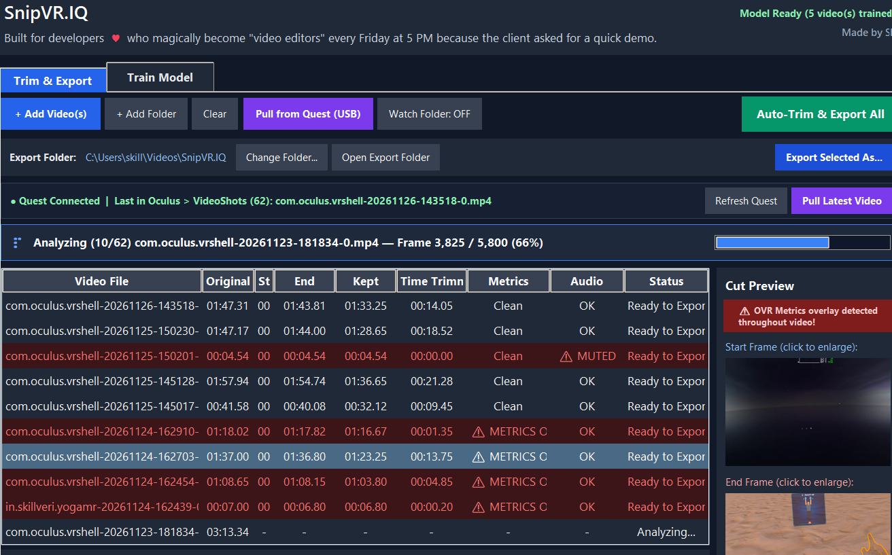

<p align="center">
  
</p>

<h1 align="center">SnipVR.IQ</h1>

<p align="center">
  <em>Built for developers ❤️ who magically become "video editors" every Friday at 5 PM because the client asked for a quick demo.</em>
</p>

<p align="center">
  Trainable Windows desktop app that automatically removes VR/MR initialization menus, 3-dot loading clutter, and ending black fades—leaving only the clean center recording ready to send.
</p>

---

## App Preview



*Main **Trim & Export** workspace showing live USB Quest detection (`Oculus > VideoShots`), animated frame-by-frame analysis progress, red QA warnings for **OVR Metrics** overlays and **Muted Audio**, and clickable Start/End cut previews.*

---

## Key Features

- **Trainable Intro & Outro Detection**: Learns your headset's VR/MR shell and loading screens (`default_model.npz` included) and cuts cleanly right before the ending black fade. Add more examples anytime in the **Train Model** tab.
- **Live Quest USB Browser (No Local Copy Clutter)**: Detects a USB-connected Meta Quest, shows the latest recording in `Oculus > VideoShots`, lets you **Browse Quest (USB)** without copying files, and loads only the latest or selected clip into an auto-cleaned temp folder (ADB auto-downloads on first use or bundles into the `.exe`).
- **Automated Demo QA Warnings**:
  - **OVR Metrics Check**: Flags videos in red (`⚠ METRICS ON`) if the neon-green OVR Metrics HUD is left on during recording.
  - **Audio / Silence Check**: Uses FFmpeg `volumedetect` to catch accidentally muted or silent captures (`⚠ MUTED` / `⚠ NO AUDIO`) before you send them to a client.
- **Drag-and-Drop & Auto-Watch Folder**: Drop `.mp4` files or folders straight onto the window (native `tkinterdnd2`), or toggle **Watch Folder: ON** to auto-queue new recordings as they arrive.
- **Live Cut Previews & Progress**: Auto-analyzes on selection, shows clickable Start/End frame thumbnails (click to enlarge), tracks **Time Trimmed** and **Trimmed Total Duration**, and streams live FFmpeg export progress (`0%`–`100%`) with a Save As filename prompt.
- **1-Tap Mobile GitHub Pusher**: Includes `Push_To_GitHub_S24_Ultra.html` and `rebuild_all.py` for single-commit atomic pushes to `xrvnsp/SnipVR.IQ`.

---

## Tech Stack

- **Language & GUI**: Python 3.12, `tkinter` / `ttk` (Per-Monitor High-DPI aware), `tkinterdnd2`, Pillow
- **Computer Vision & Classifier**: OpenCV (`opencv-python`) + NumPy top-k cosine similarity model (`.npz`)
- **Video & Audio Engine**: FFmpeg (bundled via `imageio-ffmpeg`)
- **Quest Integration**: Google Android Platform-Tools (`adb.exe`)
- **Windows Packaging**: PyInstaller (`--onefile --windowed`) via `build_portable_bundle.bat`

---

## Quick Start (Windows)

### Option 1: Build Standalone `SnipVR.IQ.exe` (Recommended)
Double-click **`build_portable_bundle.bat`**. It automatically detects Python 3.12, installs all dependencies, bundles FFmpeg, `tkinterdnd2`, ADB, and `app_icon.ico`, and outputs a portable **`dist\SnipVR.IQ.exe`**.

### Option 2: Run Directly from Source
Double-click **`run_app.bat`** to create `.venv`, install dependencies, and launch the app.

---

## Refresh Release & 1-Tap GitHub Pusher

```bash
python3 rebuild_all.py "your commit message here"
```

---

<p align="center">
  Made by <strong>SP</strong>
</p>
